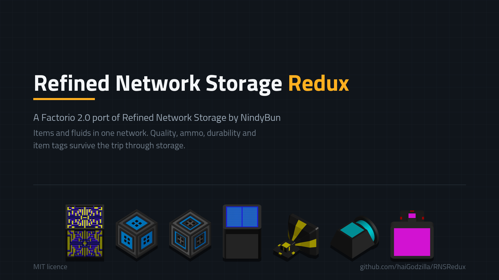

# Refined Network Storage Redux

Digital item and fluid storage for Factorio 2.0. Cables connect a **Network
Controller**, **Storage Drives** hold the contents, and **IO Buses** move items and
fluids between the network and the machines around it.

This is the Factorio 2.0 port of [Refined Network
Storage](https://mods.factorio.com/mod/RefinedNetworkStorage) by
[NindyBun](https://github.com/NindyBun/RefinedNetworkStorage), which is 1.1 only and
tagged deprecated on the mod portal. It is an independent project, not a GitHub fork
of the original.

- **Mod portal:** https://mods.factorio.com/mod/RNSRedux
- **Factorio:** 2.0 (Space Age is optional)
- **Licence:** MIT, see [`LICENSE`](LICENSE) and [`NOTICE`](NOTICE)

## What it covers

- **Storage Drives** — items at 4k / 16k / 64k / 256k, fluids at 25k / 100k / 400k /
  1600k, each with its own filter list and whitelist/blacklist mode.
- **Cables** — 10 colours that never connect across colours, plus underground cables
  that bridge up to 9 tiles.
- **IO Buses** — item bus, fluid bus, and an external bus that makes a chest or
  machine part of the network directly.
- **Network Grid** — opens the network so items can be moved in and out by hand.
- **Priority** — every component takes a priority from -5 to 5.

Storage runs on engine script inventories, so quality, ammo, durability, health and
item tags survive a round trip through the network. Quality items are refused at the
drive input instead of being silently merged or downgraded.

**Not researchable yet:** Wireless Transmitter, Portable Wireless Grid, Personal
Player Port, Network Transmitter, Network Receiver, Detector, and the wireless range
bonus technologies. The prototypes are in the mod; the technologies are disabled.

**No save migration.** There is no path from the 1.1 original. Add this mod to a new
save, not to one that already ran Refined Network Storage.

## Installing

Install **Refined Network Storage Redux** through the in-game mod browser, or drop a
release zip into your Factorio `mods` folder. Space Age does not need to be installed.

## Known limitations

- Hovering over a placed drive shows `Storage: 0/0`. The drive's own window shows the
  real contents.
- A cable of a second colour connected to a drive that is already part of a network
  bridges the two networks, even though cables of different colours otherwise never
  connect. Connect only one cable colour per drive.
- The Item IO Bus does not take items straight out of a mining drill. Route through a
  chest or place the bus at the machine that uses the ore.
- The Network Grid can flicker for a moment when a new item type is added by hand. The
  stored amounts are not affected.

## Repository layout

| Path | Contents |
| --- | --- |
| `data.lua`, `data-updates.lua`, `data-final-fixes.lua`, `settings.lua` | Data stage |
| `prototypes/` | Entities, items, recipes, technologies |
| `scripts/` | Control stage: objects, tick loop, GUI, migration |
| `utils/constants.lua` | Entity, item and sprite names shared by both stages |
| `utils/Util.lua` | Shared helpers |
| `graphics/` | Sprites |
| `locale/` | `en`, `fr` |

All mod prototype names start with `RNS_`. Code relies on that prefix.

## Development

There is **no build step and no automated test suite**. Verification happens in the
game: log lines prefixed `RNSRedux`, and the in-game profiler. Changes in the data
stage need a full game restart, changes in the control stage only a save reload.

House rules this project follows: read before changing, make the smallest change that
holds, and never claim a fix works unless it was measured in the game. "Fixed,
untested" is its own status.

Bug reports are welcome on the [mod portal](https://mods.factorio.com/mod/RNSRedux)
discussion page.

## Credits and licence

Refined Network Storage Redux is a port of **Refined Network Storage** by **NindyBun**,
used and published under the **MIT licence**. Everything not changed by the port comes
from the original. The 2.0 port and the rebuilt storage layer are by
[haiGodzilla](https://github.com/haiGodzilla). See [`NOTICE`](NOTICE) for the full
attribution and [`LICENSE`](LICENSE) for the licence text.
